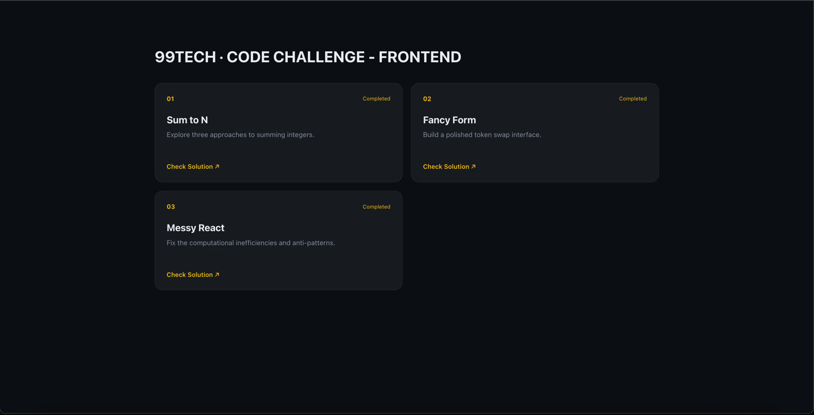
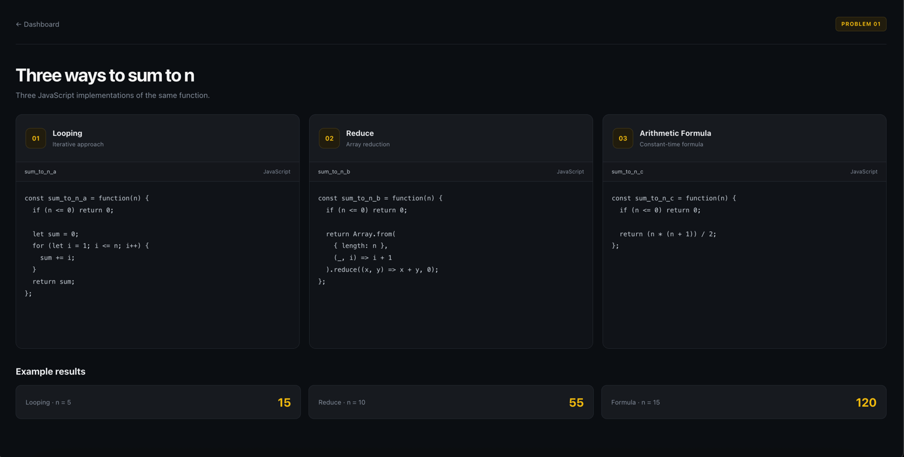
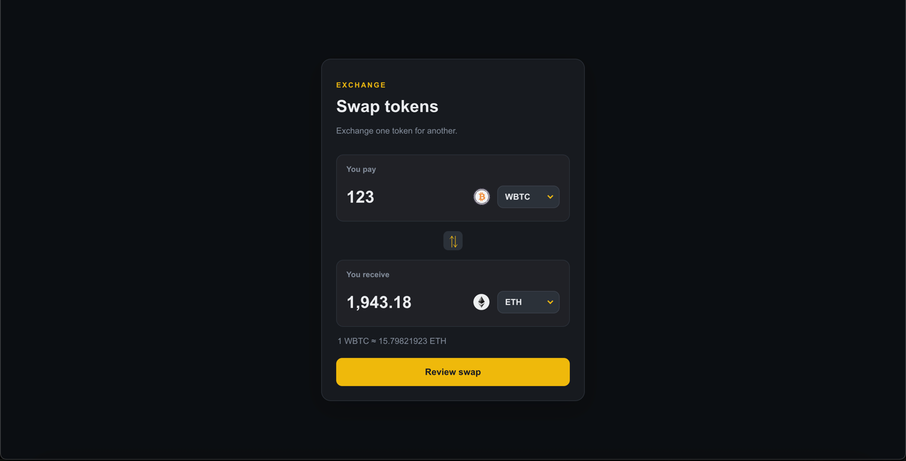
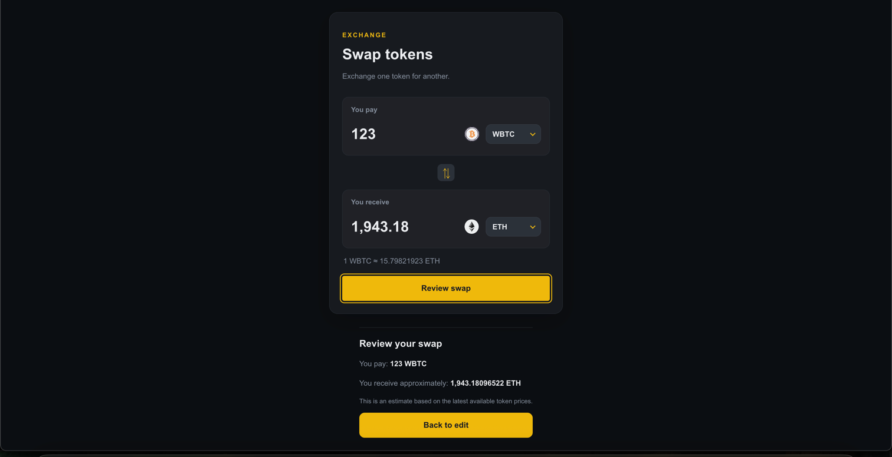
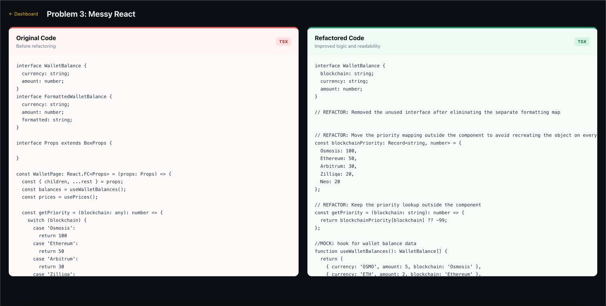

# 99Tech Code Challenge #1

This repository contains my solutions for the 99Tech Code Challenge, built using JavaScript, React, TypeScript, and Vite.

## Screenshots

### Dashboard



### Problem 1 — Sum to N



### Problem 2 — Fancy Form



**Swap review**



### Problem 3 — Messy React



## Problem 1 — Sum to N

**Implementation:** `src/problem1/sum_to_n.js`

Implemented three approaches to calculate the sum from 1 to N:

- Using a `for` loop.
- Using `reduce()`.
- Using a mathematical formula.

**Assumption:** Returns `0` for zero and negative integers.

## Problem 2 — Fancy Form

**Implementation:** `src/problem2/`

Built a Binance-inspired token swap interface using React, TypeScript, and Vite.

### Features

- Dark, responsive interface.
- Token selection with token icons.
- Token prices fetched from the provided API.
- Automatic receive-amount and exchange-rate calculation.
- Input validation and prevention of selecting the same token twice.
- Swap-direction switcher.
- Review screen showing the selected tokens and estimated amounts.
- Loading and error handling for price retrieval.

### Main files

- `src/problem2/App.tsx` — Main interface.
- `src/problem2/script.js` — Supporting script.
- `src/problem2/types.ts` — TypeScript types.
- `src/problem2/style.css` — Styling.
- `src/problem2/utils/exchange.ts` — Exchange calculation logic.

### APIs used

- Token prices: https://interview.switcheo.com/prices.json
- Token icons: https://github.com/Switcheo/token-icons/tree/main/tokens

**Note:** The receive amount is an estimate based on available token prices. The review screen does not execute a real blockchain transaction.

## Problem 3 — Messy React

**Implementation:** `src/problem3/`

This page compares the original challenge code with my refactored version side by side, making the problems and improvements easier to review.

### Main files

- `src/problem3/App.tsx` — Code comparison UI.
- `src/problem3/originalCode.tsx` — Original challenge code.
- `src/problem3/refactoredCode.tsx` — Refactored version.
- `src/problem3/style.css` — Comparison page styling.

### Fixes and improvements

1. **Fixed an undefined variable:** Replaced the incorrect `lhsPriority` reference with the declared `balancePriority` variable.

2. **Fixed the wallet balance type:** Added the missing `blockchain` property to the `WalletBalance` interface.

3. **Simplified filtering:** Replaced nested conditions with a single return statement. The refactored version assumes that only positive balances on supported blockchains should be displayed.

4. **Improved sorting:** Simplified the comparator to sort by blockchain priority in descending order. Equal priorities correctly return `0`.

5. **Moved the priority mapping outside the component:** Avoids recreating the mapping and priority lookup function on every render.

6. **Removed an unnecessary `useMemo` dependency:** Removed `prices` from the dependency array because it is not used in the sorting or filtering calculation.

7. **Removed redundant formatting work:** Eliminated the separate `formattedBalances` mapping and formatted each amount directly when creating the wallet row.

8. **Fixed the missing formatted amount:** Passed `balance.amount.toFixed()` directly as `formattedAmount`, rather than referencing a property that does not exist on `WalletBalance`.

9. **Improved React keys:** Replaced the array index with `balance.currency`, assuming each currency is unique in the displayed list.

10. **Simplified component props:** Used standard `div` props instead of relying on the unavailable `BoxProps` type.

11. **Removed unused values:** Removed the unused map index and unnecessary destructuring of `children`.

12. **Improved readability:** Kept the filtering, sorting, formatting, and row-rendering logic straightforward and easier to follow.

The goal was to fix the existing bugs, remove unnecessary work, and make the code easier to maintain while keeping the refactored version close to the original problem.

## AI Usage

I used AI as a development assistant during this challenge.

- Used AI to build the UI interfaces as a React application to demonstrate my solutions.
- Used AI to review and verify my solutions and identify potential issues.
- Used AI to improve code readability, follow best practices, and review the overall UI layout and styling.

I reviewed the suggestions and made adjustments based on my understanding of the requirements. AI was used to support development and verification, while I remained responsible for reviewing the implementation and final solutions.

## Tech Stack

- React
- TypeScript
- JavaScript
- Vite
- CSS
- Fetch API

## Run the Application

From the project root, install dependencies and start the development server:

```bash
npm install
npm run dev
```

Open the local URL provided by Vite, usually `http://localhost:5173`.

## Access the Problems

- Dashboard: `http://localhost:5173/`
- Problem 1: `http://localhost:5173/problem/1`
- Problem 2: `http://localhost:5173/problem/2`
- Problem 3: `http://localhost:5173/problem/3`

The dashboard is available at the root URL. Each problem can be accessed through its corresponding route, assuming the routes are configured in the application.

## Project Structure

```text
src/
├── App.tsx
├── main.tsx
├── problem1/
│   ├── App.tsx
│   ├── style.css
│   └── sum_to_n.js
├── problem2/
│   ├── App.tsx
│   ├── script.js
│   ├── style.css
│   ├── types.ts
│   └── utils/
│       └── exchange.ts
├── problem3/
│   ├── App.tsx
│   ├── originalCode.tsx
│   ├── refactoredCode.tsx
│   └── style.css
├── problem4/
├── problem5/
└── styles/
    └── global.css

docs/screenshots/
├── dashboard-desktop.png
├── problem1-desktop.png
├── problem2-desktop.png
├── problem2-review.png
└── problem3-desktop.png
```
